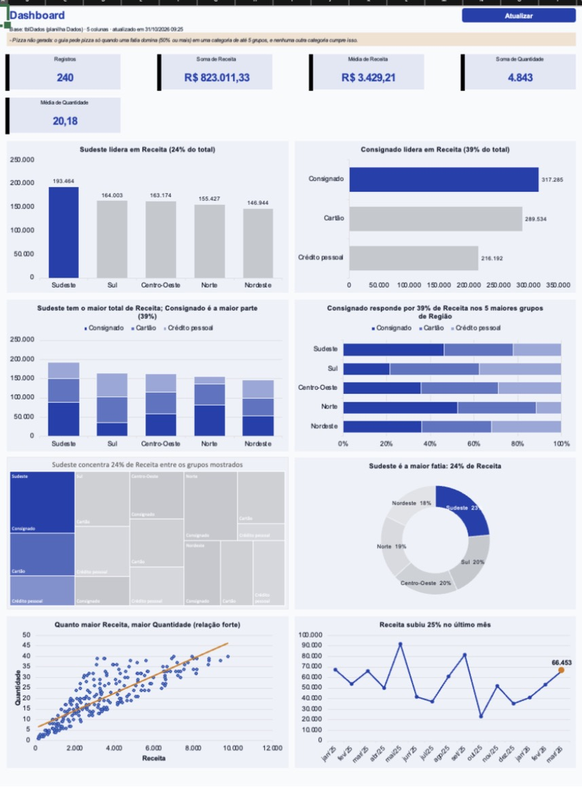
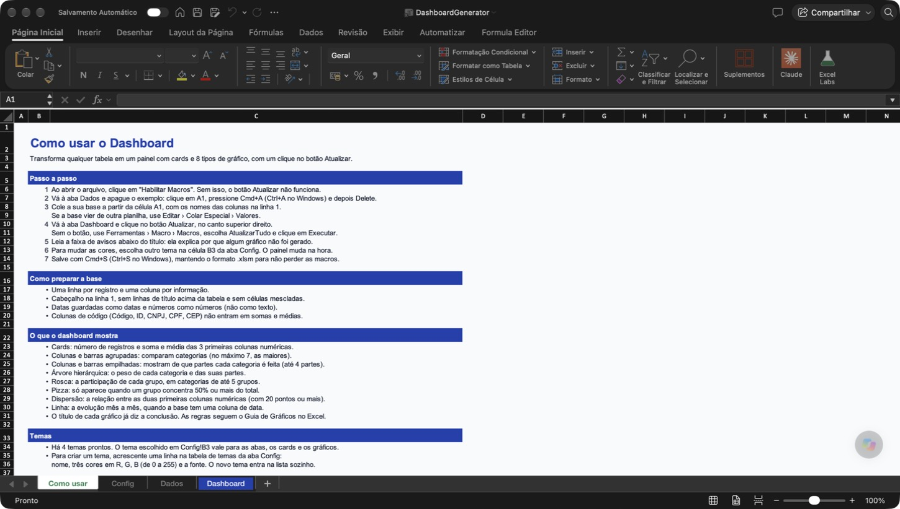
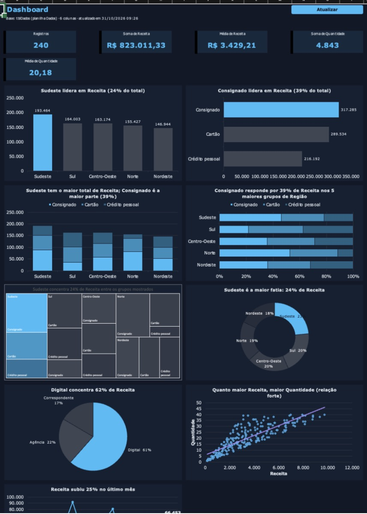
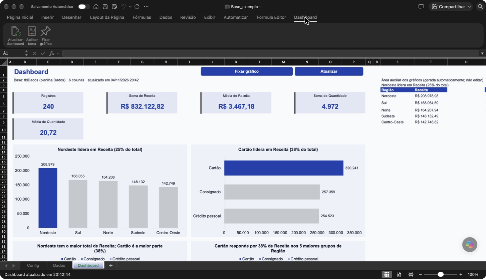
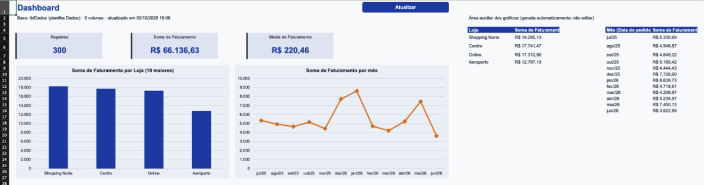
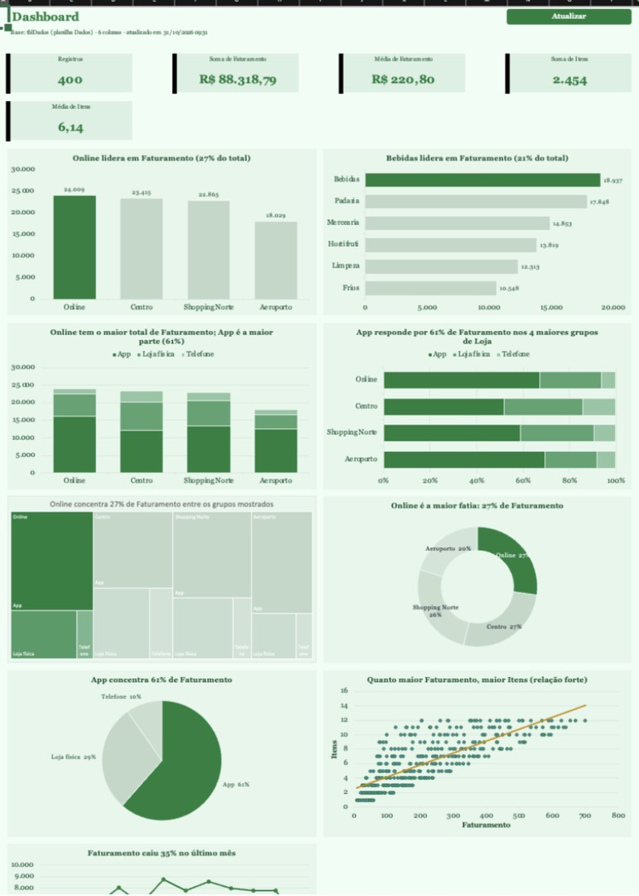
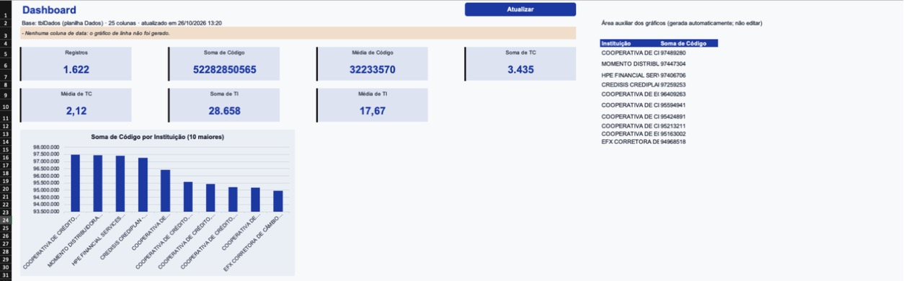
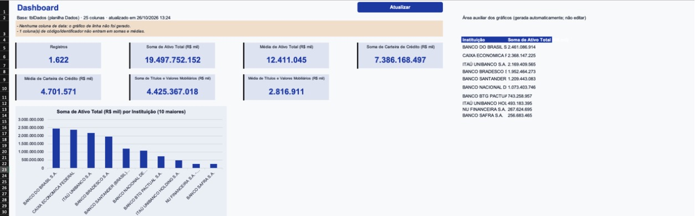

# Excel Dashboard Analytics Automation

> **EN:** Paste any tabular dataset into Excel, click one button, and get a KPI-card + 9-chart dashboard with chart type, titles and colours chosen by rules. Delivered as a ready-to-use macro workbook (`.xlsm`) and as an add-on (`.xlam`) that works on any workbook. Pure VBA + native Excel formulas, no external dependencies.

Cole uma base tabular no Excel, clique em **Atualizar** e receba um dashboard com cartões de KPI e até 9 gráficos. O tipo de gráfico, o título (que diz a conclusão) e as cores saem de regras, não de montagem manual.



## Problema que resolve

Montar um dashboard no Excel é repetitivo: a cada base nova o analista escolhe colunas, cria tabelas dinâmicas, insere gráficos, ajusta eixos, cores e títulos. O resultado varia de pessoa para pessoa, e gráficos mal escolhidos (pizza com muitas fatias, eixo que não começa no zero) enganam o leitor.

Este projeto automatiza essa etapa e embute as regras do *Guia de Gráficos no Excel para Análise de Dados* (por exemplo: até 7 categorias em colunas, pizza só quando uma fatia domina, eixo em zero, sem 3D, título com a conclusão). Esse guia é baseado no *Manual do Analista Júnior com IA*, de Natalina Costa, e não faz parte deste repositório.

## Os dois arquivos

| | `DashboardGenerator.xlsm` | `DashboardGenerator.xlam` |
|---|---|---|
| **O que é** | Pasta de trabalho pronta, com macros, abas e exemplo | Suplemento: leva o gerador para **qualquer** pasta de trabalho |
| **Quando usar** | Você quer abrir, colar a base e usar | Você já tem uma planilha sua e quer gerar o dashboard nela |
| **Onde fica o botão** | Botões **Atualizar** e **Fixar gráfico** na aba Dashboard | Guia **Dashboard** na Faixa de Opções do Excel |
| **Abas criadas** | Como usar, Dados, Config, Dashboard (e Meus gráficos sob demanda) | Cria **Config** e **Dashboard** na sua pasta (e Meus gráficos sob demanda) |
| **Troca de tema** | Lista em `Config!B3` | Lista em `Config!B3` ou botão **Aplicar tema** |
| **Aba "Como usar"** | Sim, é a primeira ao abrir | Não |

Os dois usam o mesmo código (`vba/`). O `.xlsm` é o "produto" fechado; o `.xlam` é o mesmo motor como ferramenta.

---

## Requisitos

- **Microsoft 365** (Mac ou Windows). As fórmulas usam `LET`, `UNIQUE`, `FILTER`, `SORTBY` e `TAKE`, que não existem em versões antigas.
- Macros habilitadas.

> Testado em Excel 16.114.1 para **Mac** (pt-BR). **Windows não foi testado.** Detalhes em [Testes](#testes-e-evidências).

## Instalação

```bash
git clone https://github.com/fernandofigueiredo-data/excel-dashboard-analytics-automation.git
cd excel-dashboard-analytics-automation
```

Ou baixe o ZIP pelo botão **Code › Download ZIP** do GitHub.

> **Arquivos baixados da internet:** o Excel abre em Modo Protegido. Clique em **Habilitar Edição** e depois em **Habilitar Macros**. No Windows, se as macros não rodarem, clique com o botão direito no arquivo › Propriedades › marque **Desbloquear**.

---

## Arquivo 1: `DashboardGenerator.xlsm` (modelo pronto)

### Como usar

1. Abra o `.xlsm` e clique em **Habilitar Macros**. Ele abre na aba **Como usar**, com este passo a passo dentro do Excel.
2. Na aba **Dados**, apague o exemplo (240 linhas fictícias) e cole a sua base a partir de **A1**, com os nomes das colunas na linha 1.
3. Na aba **Dashboard**, clique em **Atualizar**.
4. Para trocar o visual, escolha outro tema na lista em **Config!B3**.
5. Para editar um gráfico do seu jeito, clique nele e depois em **Fixar gráfico**.

A aba **Como usar** é a primeira ao abrir o arquivo e traz o passo a passo, como preparar a base, o que cada gráfico mostra, temas e problemas comuns:



### Temas

Quatro temas: **Corporativo Azul**, **Noite Escura**, **Verde Floresta** e **Grafite e Coral**. A troca recolore cards, botões e gráficos juntos.

| Corporativo Azul | Noite Escura |
|---|---|
|  |  |

Para criar um tema, acrescente uma linha em `tblTemas` (nome, três cores em R,G,B de 0 a 255 e a fonte). A lista de Config!B3 inclui o novo tema sozinha. Prefira fontes que existem em Mac e Windows (Arial, Verdana, Georgia, Calibri).

---

## Arquivo 2: `DashboardGenerator.xlam` (suplemento)

### Instalar

**Para uma sessão:** dê dois cliques no `.xlam` e clique em **Habilitar Macros**. A guia **Dashboard** aparece em todas as pastas abertas.

**Para carregar sempre:** no Excel, **Ferramentas › Suplementos do Excel… › Procurar…**, escolha o `.xlam` e marque a caixa.

### Usar

1. Abra a sua pasta de trabalho (qualquer uma) e deixe a planilha com os dados ativa. Cabeçalho na linha 1, dados a partir de A1.
2. Clique em **Dashboard › Atualizar dashboard**.
3. No primeiro uso, se não existir uma aba chamada `Dados`, o suplemento pergunta se pode **renomear a aba ativa para Dados**. Responda **Sim**: ele cria `Config` e `Dashboard`.
4. Troque o tema em `Config!B3` ou pelo botão **Aplicar tema**.

A guia **Dashboard** na Faixa de Opções, com os botões **Atualizar dashboard**, **Aplicar tema** e **Fixar gráfico**, numa pasta de trabalho comum (aqui, depois de clicar em Atualizar dashboard):



Exemplo em outra base: uma pasta de trabalho comum, com uma única aba "Vendas" de 300 linhas, sem nenhuma preparação.



O mesmo suplemento num livro de varejo (400 linhas), com o tema **Verde Floresta**:



### Particularidades do suplemento

- **A Faixa de Opções vem de um XML dentro do `.xlam`**, porque o VBA não cria guias. O `.xlam` já vem com ela. Se você remontar o suplemento a partir dos `.bas`, rode, com o Excel fechado:

  ```bash
  python3 scripts/adicionar_faixa_xlam.py DashboardGenerator.xlam
  ```

  Gera `DashboardGenerator_faixa.xlam` (o original não é alterado) com os botões **Atualizar dashboard**, **Aplicar tema** e **Fixar gráfico**.
- **Não abra o `.xlsm` e o `.xlam` ao mesmo tempo.** Os dois se chamam `DashboardGenerator` e o Excel recusa ("não pode abrir duas pastas de trabalho com o mesmo nome"). Um suplemento já carregado também conta: abri o `.xlam` duas vezes e a guia **Dashboard** apareceu duplicada. Se precisar dos dois, use uma cópia do `.xlam` com outro nome (por exemplo `GeradorSuplemento.xlam`); testei essa cópia sozinha, sem o `.xlsm` aberto.
- **Compartilhar o resultado não exige macro.** Cards e gráficos são fórmulas e gráficos nativos do Excel: quem recebe o arquivo vê os números recalcularem, inclusive no Excel para a Web. Só **Atualizar** (reconstruir) e trocar de tema dependem do suplemento ou do `.xlsm`.

---

## As ferramentas, uma a uma

### Atualizar
Reconstrói o dashboard inteiro a partir da base. Passos internos:

1. converte a base na tabela `tblDados`;
2. **classifica cada coluna** (data, numérica, categórica, identificador ou vazia);
3. monta os cards e os gráficos na aba **Dashboard**;
4. aplica o tema de `Config!B3`.

Quando uma regra de gráfico não é cumprida, o Dashboard escreve o motivo na faixa de avisos (por exemplo: *"Pizza não gerada: o guia pede pizza só quando uma fatia domina"*).

### Classificação automática de colunas
A macro examina até 500 células não vazias por coluna, nas primeiras 2.000 linhas:

| Se a coluna tem… | Vira | Observação |
|---|---|---|
| 80% ou mais de datas | **Data** | Habilita o gráfico de linha mensal |
| 80% ou mais de números | **Numérica** | Entra em somas e médias |
| …e o cabeçalho tem *código, cod, id, CNPJ, CPF, CEP, matrícula* | **Identificador** | **Não** entra em soma nem média |
| …só inteiros, até 25 valores distintos e cabeçalho tipo *TC, TI, tipo, classe, categoria, grupo, segmento, nível, faixa* | **Código de classe** (categórica) | "Quantidade" e "Itens" continuam numéricas |
| nenhuma célula preenchida | **Vazia** | Ignorada |
| qualquer outro caso | **Categórica** | Base para agrupamentos |

### Cards
- **Registros:** `=ROWS(tblDados)`.
- **Soma** e **Média** para até 3 colunas numéricas, via `AGGREGATE` (ignora células com erro).

### Os gráficos automáticos

| Gráfico | Dados usados | Regra aplicada |
|---|---|---|
| Colunas agrupadas | 1ª categoria × 1 a 3 medidas da mesma escala | Até 7 categorias; eixo em zero; maior em destaque, demais em cinza |
| Barras agrupadas | 2ª categoria × as mesmas medidas | Horizontais, da maior (topo) para a menor |
| Colunas empilhadas | Categoria × partes de outra categoria | Até 4 partes (3 maiores + "Outros") |
| Barras empilhadas 100% | Mesmos dados | Compara só a composição |
| Árvore hierárquica | Categoria > partes | Grupo principal em tons da cor primária |
| Rosca | Categoria com 2 a 5 grupos | Maior fatia às 12 h, furo de 60% |
| Pizza | 2 a 5 grupos, **uma fatia com 50% ou mais** | Só quando uma fatia domina |
| Dispersão (XY) | 1ª × 2ª coluna numérica | 20 pontos ou mais; linha de tendência |
| Linha | Soma mensal pela coluna de data | Último ponto destacado |

Regras para todos: o **título diz a conclusão** e é calculado por fórmula (ex.: *"Sudeste lidera em Receita (24% do total)"*); sem 3D; fonte de 12 pt; uma cor de destaque e cinza para o contexto. Os gráficos leem uma área auxiliar com fórmulas de matriz dinâmica (nomes `dsG_*`), então crescem junto com `tblDados`.

### Fixar gráfico
Os gráficos do Dashboard são refeitos a cada **Atualizar**, então edições neles se perdem. Para editar um gráfico:

1. Clique no gráfico e depois em **Fixar gráfico** (no suplemento: **Dashboard › Fixar gráfico**). Sem gráfico selecionado, o botão mostra uma lista e pede o número.
2. Uma cópia aparece na aba **Meus gráficos**. Botão direito nela para trocar o tipo, as séries ou o formato.

A cópia **não** é apagada nem repintada por Atualizar ou pela troca de tema, e continua lendo `tblDados`: se a base mudar, números e título acompanham.

**Limitações:** a árvore fixada sai com as cores padrão do Excel (o Excel para Mac não religa a série desse tipo); se a nova base não tiver as colunas usadas, a cópia fica vazia e deve ser refeita; apagar um gráfico fixado não apaga a faixa auxiliar dele.

---

## Estrutura do repositório

```
.
├── DashboardGenerator.xlsm        # modelo pronto (arquivo 1)
├── DashboardGenerator.xlam        # suplemento (arquivo 2)
├── Dashboard_base.xlsx            # base de partida: Config, 240 linhas de exemplo, Dashboard vazio
├── vba/                           # código-fonte do VBA, um módulo por responsabilidade
│   ├── modConfig.bas              # constantes, temas, estrutura, Tema Ativo
│   ├── modDados.bas               # tblDados e regra de classificação de colunas
│   ├── modTema.bas                # estilos DS_* e cores de formas e gráficos
│   ├── modDashboard.bas           # AtualizarTudo: cards, avisos, botões
│   ├── modGraficos.bas            # os 8 tipos de gráfico + linha, e suas regras
│   ├── modFixar.bas               # Fixar gráfico
│   ├── modAjuda.bas               # aba "Como usar" (só .xlsm)
│   ├── modUtil.bas                # cores RGB, nomes, estado do Application
│   ├── Config_Worksheet_Change.txt        # evento da Config (.xlsm)
│   └── clsEventosApp.cls + EstaPastaDeTrabalho_xlam.txt   # mesmo evento (.xlam)
├── scripts/adicionar_faixa_xlam.py        # cria a guia na Faixa de Opções do .xlam
├── LEIAME.md                      # documentação técnica completa e registro de testes
├── docs/img/                      # prints da guia do suplemento e da aba "Como usar"
└── teste_*/                       # capturas de tela dos testes
```

## Remontar a partir do código-fonte

Só é necessário se você alterar os `.bas`. O passo a passo completo (roteiros A para `.xlsm` e B para `.xlam`) está no [LEIAME.md](LEIAME.md).

> **Mac:** o Editor do VBA **não importa** arquivos de pastas com acento no caminho (erro `&H80004005`). Copie `vba/` para um caminho sem acento antes de importar. Os `.bas` são ASCII puro de propósito; acentos dos textos exibidos estão como `á` e são convertidos por `modUtil.U`.

## Testes e evidências

Todos no Excel 16.114.1 para Mac, macOS, pt-BR. O registro completo está no [LEIAME.md](LEIAME.md).

- **Base de exemplo (240 linhas):** 5 cards e 9 gráficos, sem avisos. Troca para "Noite Escura" recolore tudo.
- **Suplemento em livro comum** (aba "Vendas", 300 e 400 linhas): cria `Config` e `Dashboard`; 9 gráficos pela guia.
- **Botão "Atualizar dashboard" da Faixa de Opções** (04/11/2026): num livro com Config, Dados e Dashboard, gerou 240 registros, 5 cards e os gráficos; os botões **Atualizar** e **Fixar gráfico** apareceram na aba Dashboard.
- **Dados reais: IFData, Banco Central (junho/2026), 1.622 linhas × 25 colunas.** O teste expôs um erro de classificação e levou à regra de identificador e código de classe:

| Antes da correção | Depois da correção |
|---|---|
|  |  |
| Cards "Soma de Código" e "Média de TC": identificador e códigos de classe tratados como medida; eixo começando em 93,5 milhões | Cards de Ativo Total, Carteira de Crédito e Títulos e Valores Mobiliários; Top 10 com eixo em zero |

A conferência contra a planilha do analista bateu: **Soma do Ativo Total R$ 19.497.752.152 mil** e **média 12.411.045**, e o Top 10 saiu na mesma ordem e com os mesmos valores.

## Limitações conhecidas

- A aba **Dashboard** é recriada inteira a cada Atualizar: não coloque conteúdo manual nela (use **Fixar gráfico**).
- A base precisa começar em **Dados!A1**, com cabeçalho na linha 1.
- Agrupamentos usam a **1ª e a 2ª** colunas categóricas. Se uma delas tem valor único por linha (ex.: nome da instituição), o gráfico vira um ranking "10 maiores", não um agrupamento.
- Erro de fórmula (`#N/D`) em coluna numérica faz o `SUMIFS` dos gráficos devolver erro; os cards não são afetados.
- Categorias com `*`, `?` ou `~` são lidas como curinga e podem distorcer somas.
- Datas guardadas como texto contam como coluna categórica.
- Coluna de inteiros com poucos valores e cabeçalho em sigla curta maiúscula (ex.: `QTD`) é tratada como código de classe. Renomeie por extenso (`Quantidade`) para virar medida.
- A **árvore** lê o intervalo do último Atualizar; se o número de grupos mudar, clique em Atualizar. Seu título não recebe negrito e cor do tema.
- **Não testado:** Windows; instalação permanente em Suplementos do Excel; botão **Aplicar tema** da Faixa de Opções (chama a mesma rotina da troca pela Config).

## Licença

[MIT](LICENSE).
